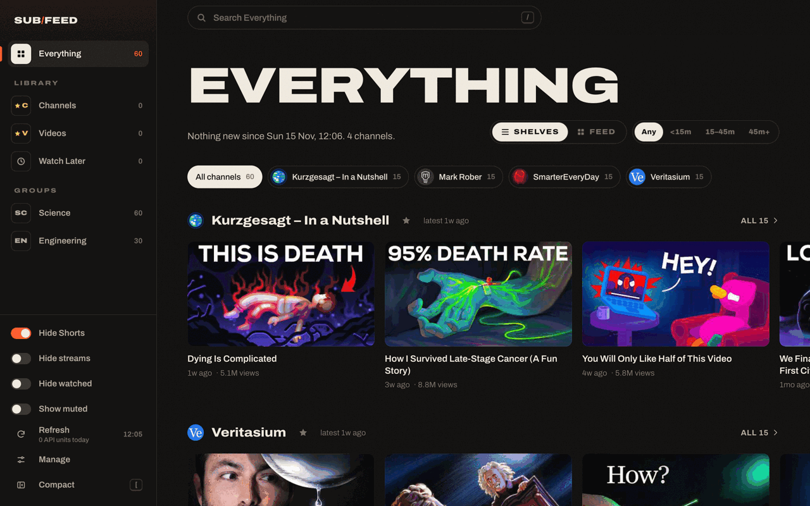

# subfeed

A self-hosted page of the latest videos from the YouTube channels you pick, sorted into your own topics.



subfeed reads each channel's public RSS feeds and keeps every video it sees in a local SQLite database, so the list grows over time. Videos play on the page in the YouTube player. Without a YouTube Data API key, subfeed also reads public channel and watch pages, for channel pictures and shared video links. The API key is the supported way to get anything beyond RSS. subfeed is an unofficial tool and is not affiliated with or endorsed by YouTube or Google.

## Quick start

subfeed needs Node 26 or later and has no dependencies to install. Node 26 is the first release where `node:sqlite` runs without an experimental warning and where `node --test` takes a folder, which `npm test` uses.

```sh
git clone <your-fork-or-the-public-url> subfeed
cd subfeed
npm start
```

Open http://localhost:4173. The first start creates an empty database in `data/subfeed.db`. To fill it, do one of these:

- Add channels on the Manage page.
- Import your YouTube subscriptions from Google Takeout. See [Import subscriptions](docs/features.md#import-subscriptions).
- Connect your YouTube subscriptions, so subfeed offers every channel you follow there. See [Connect your YouTube subscriptions](#connect-your-youtube-subscriptions).
- Before the first start, copy `channels.example.json` to `channels.json` and edit it. A new database imports that file once.

Run the tests with `npm test`.

## Connect your YouTube subscriptions

subfeed can read the channels you subscribe to on YouTube and offer the ones it does not have yet. It needs no Google sign-in: it reads your subscriptions through the YouTube Data API, which only works when they are public. It only reads. Nothing in subfeed changes your YouTube account, and a channel you unsubscribe from on YouTube stays in subfeed.

1. Get a YouTube Data API key and put it in `.env` as `YOUTUBE_API_KEY=<key>`. See [YouTube Data API](docs/youtube-api.md).
2. Make your subscriptions public. On YouTube, open **Settings**, then **Privacy**, and turn off **Keep all my subscriptions private**. Anyone who opens your channel page can then see whom you subscribe to.
3. Find your channel id on [youtube.com/account_advanced](https://www.youtube.com/account_advanced). It starts with `UC`.
4. Add it to `.env` and restart the server:

   ```sh
   YOUTUBE_CHANNEL_ID=UCxxxxxxxxxxxxxxxxxxxxxx
   ```

   With [Docker](#docker), you can set it in the compose file's `environment:` block instead, since it is not a secret.
5. Open the Manage page. The **From YouTube** panel appears after the first refresh, which runs at start. It says how many channels you subscribe to on YouTube are not in subfeed, and the Manage item in the sidebar has a dot while there are any. Click **Review**, pick topics, and add the channels you want.

Unticked channels go to Unsubscribed, so they are not offered again. A channel you unsubscribe from in subfeed is not offered again either. A channel you delete is offered again while you still subscribe to it on YouTube. Each refresh, every 30 minutes, spends 1 API unit per 50 subscriptions. If the panel reports an error, the message says what to fix, for example private subscriptions or a wrong channel id. See [From YouTube](docs/features.md#from-youtube) for details.

## Set up with an agent

A coding agent such as Claude Code can install subfeed and fill it for you. Ask it to set up subfeed by following this README, and tell it which channels and topics you want. The steps below are written for the agent.

1. Check that `node --version` prints v26 or later. Install nothing else: subfeed has no dependencies.
2. Clone the repository and run `npm start` in the background. The server is ready when it prints `subfeed running at http://localhost:4173`.
3. Ask the user which channels and topics they want, unless they already said. Add them through the HTTP API while the server runs. Every request other than `GET` must send `Content-Type: application/json`.

   ```sh
   curl -X POST -H 'Content-Type: application/json' -d '{"name":"Science"}' http://localhost:4173/api/topics
   curl -X POST -H 'Content-Type: application/json' -d '{"input":"@examplechannel","topics":["science"]}' http://localhost:4173/api/channels
   ```

   The first answer holds the topic's `id`, which the second request uses. `input` takes a channel handle or URL. To add all of the user's YouTube subscriptions instead, ask them for `subscriptions.csv` and follow [Import subscriptions](docs/features.md#import-subscriptions).
4. Check that `curl 'http://localhost:4173/api/videos?limit=5'` lists videos. Then give the user http://localhost:4173.
5. Optional: ask the user for a YouTube Data API key. Put it in `.env` as `YOUTUBE_API_KEY=<key>` and restart the server. The key turns on full upload history, video lengths and the Hot sort. Never make up a key or commit `.env`. See [YouTube Data API](docs/youtube-api.md).
6. Optional: connect the agent to subfeed, so it can list new videos and manage Watch Later for the user. For Claude Code, run `claude mcp add --transport http subfeed http://localhost:4173/mcp`. See [MCP](docs/mcp.md).
7. To keep subfeed running after a restart, use [Docker](#docker) or the user's own service manager. Read [Security](#security) before you bind any address other than `127.0.0.1`.

To change subfeed's code, read [AGENTS.md](AGENTS.md) first.

## What it does

- Lists the videos of each topic as shelves, one row per channel, or as one feed, newest first. See [Groups and views](docs/features.md#groups-and-views).
- Marks the videos published since your last visit, on every device that opens the server. See [New videos and the last visit](docs/features.md#new-videos-and-the-last-visit).
- Keeps a Watch Later queue that plays in order and empties as you watch. See [Watch Later](docs/features.md#watch-later).
- Resumes each video where the player stopped, on every device. See [The player](docs/features.md#the-player).
- Searches video titles and descriptions. See [Search](docs/features.md#search).
- Hides videos by title words with mute and route rules. See [Rules](docs/features.md#rules).
- Sends an [ntfy](https://ntfy.sh) notification when a favorite channel uploads. See [Notifications](docs/features.md#notifications).
- With a YouTube Data API key, loads each channel's full upload history, video lengths, and a Hot sort by views per hour. See [YouTube Data API](docs/youtube-api.md).
- Offers the channels you subscribe to on YouTube that it does not have yet. See [Connect your YouTube subscriptions](#connect-your-youtube-subscriptions).
- Installs as a web app on a phone, and takes video links from the share sheet. See [Install on a phone](docs/features.md#install-on-a-phone).
- Answers MCP at `/mcp`, so Claude can read and change your subscriptions. See [MCP](docs/mcp.md).
- Writes a daily snapshot of the database. See [Backups](docs/database.md#backups).

## Configuration

The server reads its settings from the environment. At start, the server, `bin/backfill.mjs` and `bin/add-channel.mjs` also load a `.env` file from the checkout folder, if one exists. A variable that is already set in the environment wins over the file. git ignores `.env`, so keep keys and tokens there.

| Variable | Default | Effect |
| --- | --- | --- |
| `PORT` | `4173` | The port the server listens on. `0` picks a free port, and the startup line names it. |
| `HOST` | `127.0.0.1` | The address the server binds. The default accepts connections from this machine only. `0.0.0.0` accepts them from the network. |
| `SUBFEED_DB` | `data/subfeed.db` | The database file. The server, `bin/add-channel.mjs`, `bin/backfill.mjs` and `bin/export-channels.mjs` read it. The server writes its backups to a `backups` folder next to the file. |
| `YOUTUBE_API_KEY` | none | A YouTube Data API v3 key. It turns on video lengths and kinds, the Hot sort, backfills, and lookups by API instead of channel pages. The server, `bin/backfill.mjs` and `bin/add-channel.mjs` read it. See [YouTube Data API](docs/youtube-api.md). |
| `YOUTUBE_CHANNEL_ID` | none | Your own YouTube channel id, `UC` and 22 more characters. With it and `YOUTUBE_API_KEY`, every refresh reads your public subscriptions and the Manage page offers the channels that are not in subfeed yet. An id in another form is logged at start and ignored. See [From YouTube](docs/features.md#from-youtube). |
| `NTFY_URL` | none | The ntfy topic URL for upload notifications and backup alerts. Without it, notifications are off. |
| `NTFY_TOKEN` | none | The access token for the ntfy topic, if the topic needs one. |
| `ANTHROPIC_API_KEY` | none | An Anthropic API key. With it, Claude suggests topics when you import subscriptions. Without it, subfeed matches topic names against each channel's title and description. |
| `ALLOWED_HOSTS` | none | A comma-separated list of extra hosts that browsers may use to reach the server, as they send them in `Host`: the name alone for the default port, `host:port` otherwise. `localhost`, `127.0.0.1` and `[::1]` with the server's port are always allowed. See [Request checks](docs/api.md#request-checks). |

## Docker

The `Dockerfile` builds an image that runs the server on port 4173 and keeps the database in the `/app/data` volume. The image sets `HOST=0.0.0.0`, so the container accepts connections from outside it. A `compose.yaml` for it:

```yaml
services:
  subfeed:
    build: .
    restart: unless-stopped
    ports:
      - "8080:4173"
    volumes:
      - ./data:/app/data
    env_file:
      - path: .env
        required: false
    environment:
      ALLOWED_HOSTS: subfeed.example.ts.net,192.168.1.50:8080
```

Put the variables from [Configuration](#configuration) that hold secrets in `.env` next to `compose.yaml`. Without the file, the container starts with none of them. `ALLOWED_HOSTS` must list every host and port that browsers use to reach the container. Without it, the server refuses every request that does not use `localhost` with the container's port. If a reverse proxy passes on a different `Host`, list that one instead.

The server runs as the `node` user, uid 1000 and gid 1000, so that user must own the `data` folder. Create the folder before the first start and give it to uid 1000. A `data` folder from a container that ran as root holds files that root owns, so change their owner too:

```sh
mkdir -p data
sudo chown -R 1000:1000 data
```

To seed the database from a list of your own, mount it read-only at `/app/channels.json` before the first start.

On SIGTERM, `docker stop` included, the server stops taking connections, stops a running backfill where it is so the next start continues it, closes the database and exits. See [Stop the server](docs/database.md#stop-the-server).

## Documentation

- [Features](docs/features.md) covers the groups and views, the player, Watch Later, search, rules, managing channels, importing subscriptions, the phone app, and notifications.
- [YouTube Data API](docs/youtube-api.md) covers the API key, backfills, video lengths and kinds, and channel pictures.
- [Database and refreshes](docs/database.md) covers the database file, how refreshes work, stopping the server, and backups.
- [HTTP API](docs/api.md) lists the routes and the checks every request passes.
- [MCP](docs/mcp.md) covers the MCP endpoint and its tools.

## Security

subfeed has no sign-in. Anyone who can reach its port can change its data and call the MCP tools that change data. By default the server binds `127.0.0.1`, so only this machine reaches it. When you set `HOST=0.0.0.0` or run the Docker image, keep the port on a private network, such as your LAN or a tailnet, and never expose it to the internet.

The server checks every request so that other web pages cannot use it through your browser. The `Host` header must name an allowed host, and a request other than `GET`, `HEAD` or `OPTIONS` must send `Content-Type: application/json`. See [Request checks](docs/api.md#request-checks).

## Contributing

Run `npm test` before you send a change. subfeed takes no dependencies, so a change that adds one is not accepted. Developer notes are in [AGENTS.md](AGENTS.md).

## License

The Archivo font files in `public/` are under the SIL Open Font License 1.1. See [public/archivo-OFL.txt](public/archivo-OFL.txt). The rest of subfeed is MIT. See [LICENSE](LICENSE).
